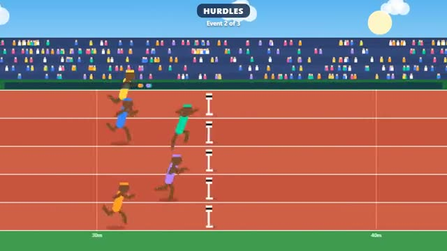

# Field Day

Mash your way to gold in three quick events. A multiplayer starter game from [Multiplayer Agent](https://multiplayeragent.com): 2D, party, 2–8 players, with bots that fill the empty lanes.

## How it plays

A sprint, the hurdles and the javelin, lane by lane. Alternate two keys (or two buttons) as fast as you can to run, jump the hurdles on time, and hold to raise the javelin before the line. Medals go to the most points after all three.

**Controls:** ← → (or A D) alternately to run, Space to jump or hold-and-release to throw · touch: L and R buttons, JUMP / THROW.

## Make it yours in the Game Builder

Open the [Game Builder](https://multiplayeragent.com), choose **Start from a starter game** and pick Field Day. It opens as version 1 in your studio, ready to play and publish. Then ask for changes, for example:

- Add a long jump as a fourth event
- Make it a moon base with low gravity hurdles
- Give a speed boost for a perfect hurdle jump

## Run it yourself

1. Get a free publishable key (`pk_…`) at [multiplayeragent.com](https://multiplayeragent.com).
2. In `index.html`, put it in place of `pk_REPLACE_ME` in the `MP_CONNECT` block.
3. Open `index.html` in a browser. No build step and no server needed.

Without a key it still runs, offline against bots.

## How it is built

- One `index.html`. The comment at the top of the script maps the code and explains the multiplayer.
- **Host-run rounds:** The host's browser starts each event, collects every time and throw, and hands out the points; if it leaves, the next player takes over. Each athlete runs on its own player's screen, and its time is measured there from the starting gun.
- **Bots:** Bots fill the empty lanes and mash at human speeds, so even alone you race a full field.
- **Leaderboard:** Your fastest 100m dash.
- **Live sync:** Every runner moves in its lane on everyone's screen.
- `?attract` runs it offline, bots only, starting with the hurdles. The preview video is recorded from it.

## License

MIT.
